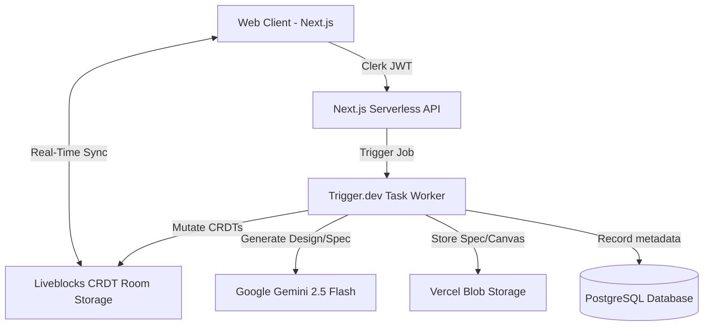
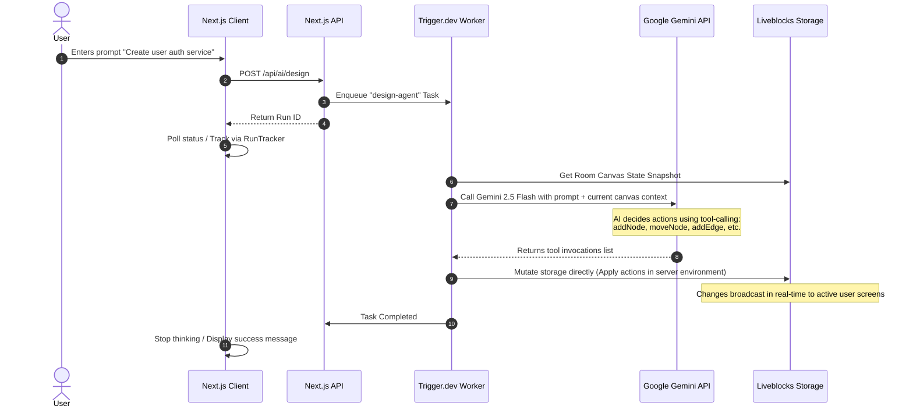

# Ghost AI — Architecture & Design Specification

This document details the system design, real-time collaboration workflows, data persistence pipelines, background task scheduling, and backend API routes of **Ghost AI**.

---

## 1. System Architecture Overview

Ghost AI leverages a hybrid architecture combining real-time document synchronization (multiplayer canvas) with background processing tasks to run generative AI agents without blocking client web requests.



---

## 2. Real-Time Collaboration & Synchronization

Collaboration is driven by the integration of **Liveblocks Multiplayer Engine** and **React Flow (XYFlow)**:

- **State Model (CRDTs)**:
  The canvas diagram state is modeled as a Liveblocks `LiveObject` named `flow`, containing two nested maps:
  - `nodes`: `LiveMap<string, LiveblocksNode<CanvasNode>>`
  - `edges`: `LiveMap<string, LiveblocksEdge<CanvasEdge>>`
  This guarantees conflict-free concurrent editing (CRDT) across all users.
  
- **Client Synchronization**:
  Clients subscribe to the room document via `@liveblocks/react-flow`. Drag operations, size updates, text inputs, and edge connections are instantly broadcast to and merged by all peers.
  
- **User Presence**:
  Active users broadcast their presence containing:
  - `cursor`: `(x, y)` coordinate mapped from screen space to canvas flow space.
  - `thinking`: boolean flag indicating if their AI architect is currently compiling or drafting.
  Collaborator cursors are rendered using SVGs colored with the user's allocated color profile.
  
- **Canvas Auto-Save Pipeline**:
  Local canvas edits (nodes/edges change) are debounced by **2 seconds** via the `useCanvasAutosave` hook. When the timer fires, the client issues a `PUT` request containing the graph JSON snapshot to `/api/projects/[projectId]/canvas`. The server pushes this file to Vercel Blob and records the URI in PostgreSQL.

---

## 3. Background Task Orchestration (Trigger.dev & Gemini)

To prevent serverless execution timeout limits (typically 10-30s in serverless hosting), all generative AI operations run as background tasks on **Trigger.dev v3**.

### A. Design Agent Pipeline



### B. Technical Specification Generation

1. The client triggers the `generate-spec` task.
2. The Trigger worker gathers the canvas layout metadata (coordinate mapping, shapes, colors, and connection edges) along with the collaborative chat transcript logs.
3. This is formatted into a system specification prompt and compiled by Gemini 2.5 Flash into six core chapters in Markdown.
4. The compiled Markdown spec is saved in **Vercel Blob Storage** and registered inside the database `ProjectSpec` table.

---

## 4. Database Schema Reference

The relational database is configured via Prisma (`prisma/models/project.prisma`).

```
  +------------------+          +------------------------+
  |     Project      |--------->|  ProjectCollaborator   |
  |------------------|          |------------------------|
  | id (PK CUID)     |          | id (PK CUID)           |
  | ownerId          |          | projectId (FK)         |
  | name             |          | email                  |
  | description      |          | createdAt              |
  | status (Enum)    |          +------------------------+
  | canvasBlobUrl    |
  | createdAt        |          +------------------------+
  | updatedAt        |          |      ProjectSpec       |
  +------------------+          |------------------------|
           |                    | id (PK CUID)           |
           +------------------->| projectId (FK)         |
           |                    | filePath (Blob URI)    |
           |                    | createdAt              |
           |                    +------------------------+
           |
           |                    +------------------------+
           |                    |        TaskRun         |
           |                    |------------------------|
           +------------------->| id (PK CUID)           |
                                | runId (Unique)         |
                                | projectId              |
                                | userId                 |
                                | createdAt              |
                                +------------------------+
```

---

## 5. API Endpoint Reference Catalog

All API endpoints are authorization guarded. They verify Clerk JWT signatures and query database ownership before performing actions.

### Projects & Collaborators
- `GET /api/projects`: Fetch projects owned by the user.
- `POST /api/projects`: Create a new project record.
- `PATCH /api/projects/[projectId]`: Update project metadata (e.g. name/description).
- `DELETE /api/projects/[projectId]`: Cascade delete the project, specs, and storage maps.
- `GET /api/projects/[projectId]/collaborators`: Retrieve list of active collaborator user profiles.
- `POST /api/projects/[projectId]/collaborators`: Invite a collaborator by email.
- `DELETE /api/projects/[projectId]/collaborators`: Remove an invited collaborator.

### Canvas Snapshots
- `GET /api/projects/[projectId]/canvas`: Retrieve canvas JSON file from Vercel Blob.
- `PUT /api/projects/[projectId]/canvas`: Save canvas JSON snapshot to Vercel Blob and update project schema.

### AI Task Execution
- `POST /api/ai/design`: Launch the `design-agent` task.
- `POST /api/ai/design/token`: Retrieve a public read-only tracker token for `design-agent` execution.
- `POST /api/ai/spec`: Launch the `generate-spec` task.
- `POST /api/ai/spec/token`: Retrieve a public read-only tracker token for `generate-spec` execution.

### Specifications
- `GET /api/projects/[projectId]/specs`: List all spec documents generated for this project.
- `GET /api/projects/[projectId]/specs/[specId]`: Stream Markdown spec content for in-app reader modal.
- `GET /api/projects/[projectId]/specs/[specId]/download`: Download the spec file directly as an attachment.
