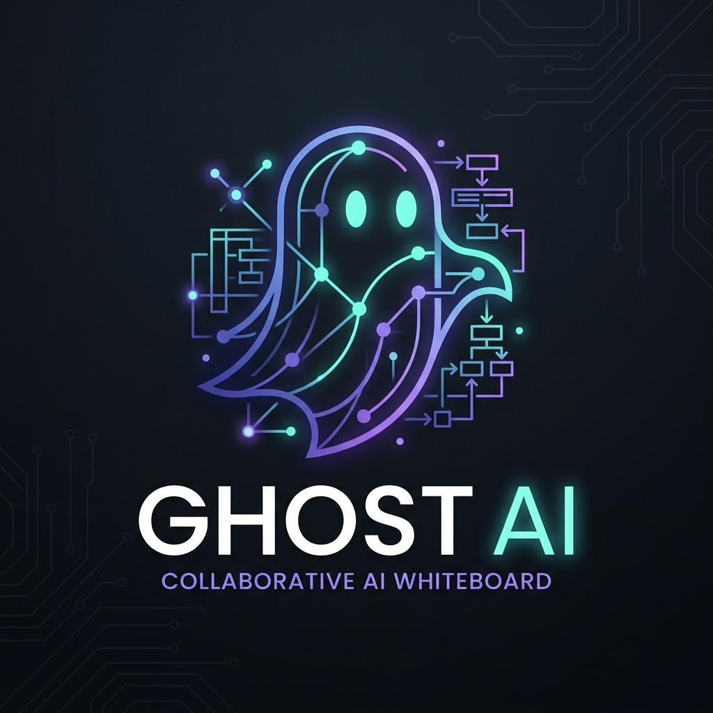
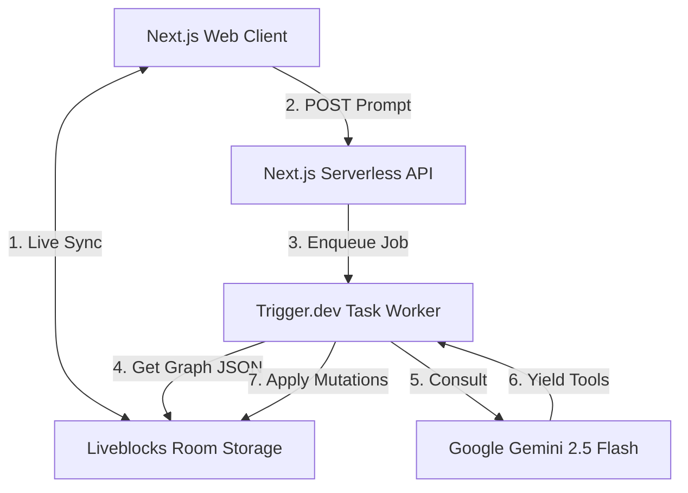

<p align="center">
  
</p>

<h1 align="center">Ghost AI</h1>

<p align="center">
  <strong>An Enterprise-Grade, Real-Time Multiplayer Whiteboard & Autonomous AI System Architect Workspace</strong>
</p>

<p align="center">
  <a href="https://opensource.org/licenses/MIT"></a>
  <a href="https://nextjs.org/"></a>
  <a href="https://www.typescriptlang.org/"></a>
  <a href="https://tailwindcss.com/"></a>
  <a href="https://reactflow.dev/"></a>
  <a href="https://liveblocks.io/"></a>
  <a href="https://trigger.dev/"></a>
  <a href="https://vercel.com/"></a>
</p>

---

## 👻 Introduction

**Ghost AI** is an advanced open-source collaborative whiteboard and automated software architecture planning application built for modern engineering teams. It allows software architects, developers, and product managers to brainstorm, construct, and document complex systems interactively, with the assistance of an autonomous AI design agent.

Describe your target system architecture in plain English (e.g. *"Design a secure, highly-available e-commerce backend with an API gateway, microservices, redis cache cluster, and a PostgreSQL database replication set"*). The built-in AI agent—powered by **Google Gemini 2.5 Flash** and running on an isolated **Trigger.dev** serverless task queue—interprets the request and autonomously places, customizes, routes, and arranges visual shapes on the multiplayer canvas in real-time. 

Simultaneously, human developers can jump into the canvas to resize nodes, edit text labels inline, change color themes from a context toolbar, connect services, or converse inside a shared room chat feed. When complete, Ghost AI converts the visual canvas graph into a multi-page technical specification markdown document, saved in Vercel Blob and downloadable instantly.

---

## 📋 Table of Contents

1. [🚀 Core Features](#-core-features)
2. [📐 Canvas Elements & Custom Primitives](#-canvas-elements--custom-primitives)
3. [⚙️ System Architecture Flow](#%EF%B8%8F-system-architecture-flow)
4. [🛠️ AI Architect Tool-Calling Specification](#%EF%B8%8F-ai-architect-tool-calling-specification)
5. [🗄️ Database Models Reference](#%EF%B8%8F-database-models-reference)
6. [🤸 Getting Started & Local Installation](#-getting-started--local-installation)
7. [🔑 Environment Variable Configurations](#-environment-variable-configurations)
8. [🔌 Available Script Reference](#-available-script-reference)
9. [🤝 Contributor Guidelines](#-contributor-guidelines)
10. [📄 License](#-license)

---

## 🚀 Core Features

### 1. Multiplayer Synchronization & Collaboration
- **CRDT Canvas Document**: Shared nodes and edges are synchronized using Liveblocks `LiveMap` objects, guaranteeing conflict-free multiplayer canvas modifications.
- **Dynamic Presence Cursors**: Collaborator cursors are rendered live in canvas coordinates, complete with the user's Clerk name badge and avatar color profile. Cursors scale and offset automatically as users zoom and pan the React Flow viewport.
- **Collaborator Cluster Stack**: A floating list at the top-right displays active room members, including Clerk profile pictures and system status tracking.
- **Shared Chat Room Feed**: Real-time collaborative workspace chat. Users see when Ghost AI is starting, thinking, editing, or completing canvas operations.

### 2. Custom Whiteboard Canvas System
- **Draggable Shape Panel**: Bottom floating dock containing standard drag-and-drop shapes. Implements a custom cursor ghost overlay to track items without native browser drag-image latency.
- **Context Toolbar**: Select any node to display a floating context toolbar to customize styling using an 8-color matte-palette.
- **Inline Text Editing**: Double-click any node label or connection edge label to open an overlay text area to customize names in-place. React Flow pan and drag listeners are bypassed during text inputs.
- **Viewport Ergonomics**: Custom control pad for locking/unlocking the canvas, fit-to-view, zoom increments, and multi-user undo/redo actions.

### 3. Serverless AI Task Scheduling
- **Trigger.dev Task Worker**: Offloads heavy LLM tool-calling execution to an isolated background task, preventing serverless functions from timing out.
- **Automatic Auto-Save**: Saves canvas states automatically, debounced by 2 seconds. Canvas JSON state snapshots are stored securely inside Vercel Blob and indexed in PostgreSQL.
- **Spec Compiler**: Converts active canvas layouts and the collaborative chat transcript into a comprehensive Markdown technical document, providing *Overview*, *Architecture*, *Data Flow*, *Technology Choices*, and *Key Considerations*.

---

## 📐 Canvas Elements & Custom Primitives

Ghost AI implements 6 custom node structures styled inside Tailwind CSS v4 using inline SVG overlays to retain scalable geometries during resize:

| Shape | Tailwind Canvas Node | Suggested Use Cases |
| :--- | :--- | :--- |
| **Rectangle** | `shape: rectangle` | Microservices, API gateways, load balancers, client UI apps |
| **Cylinder** | `shape: cylinder` | Databases, redis caches, message queues, blob storages |
| **Circle** | `shape: circle` | Event triggers, entry points, webhook listeners, user personas |
| **Pill** | `shape: pill` | Cron jobs, background workers, serverless functions, workflow scripts |
| **Hexagon** | `shape: hexagon` | External systems, third-party APIs, authentication domains |
| **Diamond** | `shape: diamond` | Load-balancing routes, decision boxes, gatekeepers |

---

## ⚙️ System Architecture Flow

Ghost AI orchestrates actions across Next.js API routes, Liveblocks, and Trigger.dev to run AI integrations asynchronously.



---

## 🛠️ AI Architect Tool-Calling Specification

When Ghost AI processes an architecture prompt, it interacts with the canvas using the following toolset:

- `addNode(id, label, shape, colorIndex, x, y)`: Instantiates a new shape on the board at specific coordinates.
- `moveNode(id, x, y)`: Relocates an existing service node.
- `resizeNode(id, width, height)`: Adjusts the bounding geometry of a canvas shape.
- `updateNodeData(id, label, shape, colorIndex)`: Overwrites properties of a node.
- `deleteNode(id)`: Removes a node and purges any connected edges.
- `addEdge(id, source, target, label)`: Draws a directed, styled connection line between handles.
- `deleteEdge(id)`: Clears a connection path.
- `finalizeDesign(summary)`: Concludes the task run and returns a 1-2 sentence description of the system architecture changes.

---

## 🗄️ Database Models Reference

Ghost AI utilizes Prisma ORM to interact with PostgreSQL.

```prisma
model Project {
  id             String               @id @default(cuid())
  ownerId        String
  name           String
  description    String?
  status         ProjectStatus        @default(DRAFT)
  canvasBlobUrl  String?              // URL pointing to Vercel Blob canvas snapshot
  createdAt      DateTime             @default(now())
  updatedAt      DateTime             @updatedAt
  collaborators  ProjectCollaborator[]
  specs          ProjectSpec[]
}

model ProjectSpec {
  id        String   @id @default(cuid())
  projectId String
  filePath  String   // URL pointing to Vercel Blob spec file
  createdAt DateTime @default(now())
  project   Project  @relation(fields: [projectId], references: [id], onDelete: Cascade)
}

model TaskRun {
  id        String   @id @default(cuid())
  runId     String   @unique
  projectId String
  userId    String
  createdAt DateTime @default(now())
}
```

---

## 🤸 Getting Started & Local Installation

### Prerequisites
* **Node.js**: v20.x or newer
* **Database**: PostgreSQL Instance
* **API Accounts**: Clerk, Liveblocks, Trigger.dev, and Google Gemini AI Studio

### 1. Project Cloning & Dependencies Setup
```bash
git clone https://github.com/RISHII7/ghost-ai.git
cd ghost-ai
npm install
```

### 2. Configure Your Database
Add your database URL to `.env.local` (e.g. `DATABASE_URL="postgres://..."`). Initialize tables and compile the client:
```bash
npx prisma migrate dev
```

### 3. Running Dev Servers
Run the Next.js client environment:
```bash
npm run dev
```
Open [http://localhost:3000](http://localhost:3000) to view the client.

In a separate terminal, launch the local Trigger.dev daemon to process background AI tasks:
```bash
npx trigger.dev@latest dev
```

---

## 🔑 Environment Variable Configurations

Set up your `.env.local` using these parameters:

| Variable | Description |
| :--- | :--- |
| `NEXT_PUBLIC_CLERK_PUBLISHABLE_KEY` | Clerk authentication publishable credentials |
| `CLERK_SECRET_KEY` | Clerk server-side verification token |
| `NEXT_PUBLIC_CLERK_SIGN_IN_URL` | Route for signing in (`/sign-in`) |
| `NEXT_PUBLIC_CLERK_SIGN_UP_URL` | Route for signing up (`/sign-up`) |
| `LIVEBLOCKS_SECRET_KEY` | Liveblocks key to authenticate room allocations |
| `TRIGGER_PROJECT_REF` | Target Trigger.dev project identifier |
| `TRIGGER_SECRET_KEY` | Trigger.dev secret token to connect workers |
| `DATABASE_URL` | PostgreSQL connection string (Append `?sslmode=verify-full` to silence driver warning) |
| `BLOB_READ_WRITE_TOKEN` | Write-access token for Vercel Blob storage |
| `GOOGLE_GENERATIVE_AI_API_KEY` | Gemini API Key |
| `GEMINI_MODEL` | *(Optional)* Model override for canvas architect (default: `gemini-2.0-flash`) |
| `GEMINI_SPEC_MODEL` | *(Optional)* Model override for documentation generator |

---

## 🔌 Available Script Reference

| Script | Command | Purpose |
| :--- | :--- | :--- |
| `npm run dev` | `next dev` | Launches Next.js local development workspace |
| `npm run build` | `prisma generate && next build` | Compiles production assets and regenerates Prisma client |
| `npm run start` | `next start` | Runs the compiled Next.js production server |
| `npm run lint` | `eslint` | Triggers linter conformance checks |

---

## 🤝 Contributor Guidelines

We welcome contributions to Ghost AI! To get started:
1. Review our [Contributing Policy](CONTRIBUTING.md) and [Code of Conduct](CODE_OF_CONDUCT.md).
2. Fork the repository and check out a branch from `main` using descriptiveConventional branch naming conventions (`feat/` or `fix/`).
3. Verify compilation and lint rules before submitting a PR:
   ```bash
   npm run lint
   npm run build
   ```

---

## 📄 License

This repository is distributed under the MIT License. See [LICENSE](LICENSE) for details.
